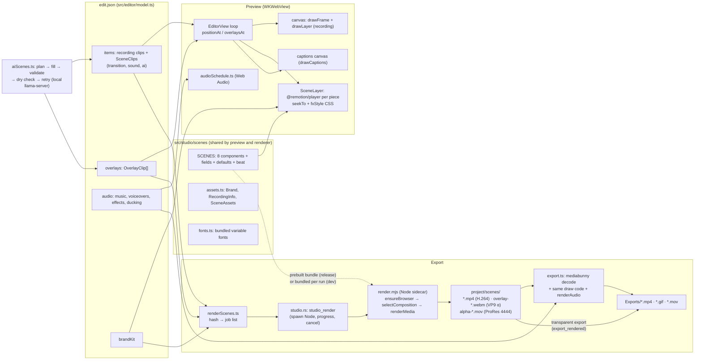

# 06 — Synthesis: Studio mode as built

What Capturita takes from Remotion, and how the pieces fit, as of 2026-10-19. This replaces the
earlier Phase 6 draft, which described a dropped design (a separate app with its own canvas
renderer). Files 00–05 are the source-level teardown this builds on. Work status and open checks
live in `docs/studio-remaining.md`.

**In one sentence:** Capturita owns the timeline, the preview and the export. Remotion only
draws the generated pieces (scenes and overlays): `@remotion/player` in the preview, and
`@remotion/renderer` (headless Chrome) to turn them into video files that the export composites.

---

## a) Architecture



Key properties:
- **One clock.** Players never run on their own; the editor seeks each one to
  `floor(time × 30)` every frame. The export picks the same frame from the rendered file.
- **One source of scene code.** The preview's Player and the renderer's bundle import the same
  `src/studio/scenes` files (the renderer aliases `remotion`, `react`, `react-dom` to the app's
  copies), and the same fonts.
- **One layering rule.** `positionAt` decides, for any output time, the recording frame, the
  scenes on screen with their transition looks (`LayerFx`), and the dip wash; preview (CSS) and
  export (canvas) apply the same values.
- **Files are a cache.** Every rendered piece is named by a hash of everything that changes its
  pixels, so an unchanged piece renders once.

---

## b) Remotion concept → what Capturita uses → status

| Remotion concept (teardown file) | Capturita uses it as | Status |
|---|---|---|
| `Composition` (01) | One per scene in `studio-renderer/entry/index.tsx`, plus `TransparentTimeline`. Size, fps and length come from each job, not the registration | Built |
| `useCurrentFrame` / `useVideoConfig` (01) | Every scene is a pure function of them; sizes in units of the short side (`layout.ts`) | Built |
| `Sequence` (01) | Only inside `TransparentTimeline`, to give each piece its own frame and length. Capturita's own timeline does the sequencing everywhere else | Built |
| `Series`, `Loop`, `Freeze` (01) | Not used | — |
| `interpolate`, `spring`, `Easing` (02) | All scene motion (about 40 `interpolate` and 40 `spring` calls) | Built |
| `random(seed)` (02) | Bursts and jitter; no `Math.random` | Built |
| `@remotion/transitions` (02 §11, 03 §6) | **Not used.** Transitions are Capturita's (`transitionFx`), because they must also apply to recording clips that Remotion never sees | Built, not verified |
| `OffthreadVideo` (03 §4) | `RecordingVideo.tsx` shows part of the screen recording inside DeviceShowcase and FeatureCallout | Built |
| `Img` (03) | Brand logo, served from the project folder | Built |
| `staticFile` / public dir (04) | Not used. The renderer serves the project folder over 127.0.0.1 with byte ranges; scenes build URLs with `assetUrl(assets, file)` | Built |
| `@remotion/google-fonts` (03 §11) | Not used: fonts are bundled `@fontsource-variable` packages, so rendering works offline and matches the preview | Built |
| `@remotion/player` (04) | One Player per scene/overlay in `SceneLayer.tsx`, driven by `seekTo`; `Thumbnail` for the AI dry check | Built |
| `@remotion/bundler` (04) | Dev: bundles per run. Release: `render.mjs --build-bundle` at app build time | Built |
| `@remotion/renderer` `renderMedia`, `selectComposition`, `ensureBrowser` (04) | `render.mjs`; Chrome Headless Shell downloaded once into the app data folder | Built; release build not run |
| Compositor binaries (04) | Shipped for arm64 and x64, relinked to `@loader_path`, re-signed | Built; not notarized yet |
| Codecs: H.264, VP9 + alpha, ProRes 4444 (04) | Scenes H.264 BT.709 limited; overlays VP9 `yuva420p` (WKWebView can't decode ProRes); transparent export ProRes 4444 `yuva444p10le` | Built |
| `@remotion/captions`, whisper packages (03 §8) | Not used: captions come from Capturita's own Whisper (`captions.rs`) and are drawn by `drawCaptions` over everything | Built, not verified |
| `<Audio>`, volume functions, `@remotion/sfx` (03 §12) | Not used: all audio is Capturita's Web Audio scheduler, with a user-licensed sound pack; scenes are silent | Built, not verified |
| Zod schemas / `calculateMetadata` (01, 05) | Not used: `SceneField[]` drives the panel and the AI's JSON schema (`propsSchema`) | Built |
| Prompt-to-motion templates (05) | Pattern only: plan → per-scene fill with schema → validate → render check → retry | Built, not run |
| `@remotion/three`, Lottie, `effects`, Lambda/Cloud Run | Out of scope | — |
| Licensing (00) | Remotion License: free for ≤ 3 employees; larger companies need a Company License. `acknowledgeRemotionLicense` is not set for the user | Decided |

---

## c) Scene data format

All in `src/editor/model.ts`; stored in `<project>/edit.json` and cleaned by `normalizeEdit`.

```ts
interface SceneClip {            // a full-frame scene in the timeline
    kind: 'scene';
    id: string;
    scene: string;               // key in SCENES
    props: Record<string, unknown>; // only that scene's own fields
    duration: number;            // seconds on the timeline
    transition?: Transition;     // into this item from the previous one
    sound?: SoundCue;            // played at the scene's beat
    ai?: Record<string, unknown>; // props the AI last wrote (hand edits differ from it)
}

interface OverlayClip {          // drawn over the timeline, doesn't change its length
    id: string;
    scene: string;               // a scene whose `use` is 'overlay' or 'both'
    props: Record<string, unknown>;
    start: number;               // output seconds
    duration: number;
    sound?: SoundCue;
    ai?: Record<string, unknown>;
}

type Transition =
    | { type: 'cut'; sound?: SoundCue }
    | { type: 'crossfade' | 'slide' | 'push' | 'wipe' | 'zoom' | 'blur' | 'dip';
        duration: number; direction?: 'left' | 'right' | 'up' | 'down'; color?: string; sound?: SoundCue };
```

What a scene component actually receives (`sceneLookProps` + `assets`):
`{ ...SCENES[id].defaultProps, ...item.props, transparent?: true (overlays), brand, recording, assets }`.
`brand` comes from the project's brand kit, `recording` is the screen track's file, offset and
size, and `assets.base` is where files are served from (`asset://` in the preview, the renderer's
local server in exports). `assets` is left out of the cache hash.

Cache file name: `sha256({version: SCENE_RENDER_VERSION, composition, props, frames, fps, width, height})`
→ `scenes/<hash>.mp4`; overlays add `kind: 'overlay'` → `scenes/overlay-<hash>.webm`; transparent
exports add `kind: 'transparent'` → `scenes/alpha-<hash>.mov`.

### Example 1: title (scene)

```json
{
  "kind": "scene", "id": "k3f9", "scene": "TitleReveal", "duration": 4,
  "props": { "eyebrow": "Introducing", "title": "Agentic Browser", "subtitle": "Your tabs, on autopilot" },
  "transition": { "type": "crossfade", "duration": 0.5 }
}
```

### Example 2: device showcase (scene showing the recording)

```json
{
  "kind": "scene", "id": "p81c", "scene": "DeviceShowcase", "duration": 5,
  "props": {
    "device": "browser",
    "segment": { "start": 12.4, "end": 17.4 },
    "placement": "side",
    "headline": "Ask once, it books the trip",
    "detail": "Works across every tab you have open",
    "url": "agentic.example.com"
  },
  "transition": { "type": "slide", "duration": 0.6, "direction": "left" }
}
```

`segment` is in source seconds of the recording; the scene plays that part through
`RecordingVideo` (`OffthreadVideo`). At 1:1, 4:5 and 9:16 `placement: 'side'` falls back to below.

### Example 3: end card (scene with a beat sound)

```json
{
  "kind": "scene", "id": "e02a", "scene": "EndCard", "duration": 5,
  "props": {
    "headline": "Try it free today",
    "cta": "Get started",
    "url": "agentic.example.com",
    "showQr": true,
    "socials": [{ "network": "x", "handle": "@agentic" }, { "network": "github", "handle": "agentic" }]
  },
  "sound": { "file": "audio/sfx-pack-click.wav", "name": "click", "volume": 0.8 },
  "transition": { "type": "dip", "duration": 0.8, "color": "#000000" }
}
```

The click plays at the EndCard's beat (1.53 s, the button press).

---

## d) The 8 scenes

Registry: `src/studio/scenes/index.ts`. All take `brand`, `recording` and `assets` besides the
settings listed. "Use" says where it can go; scenes with an overlay form also accept
`transparent` (no background), which is what allows transparent export of a single piece.

| Scene | Use | Default length | Settings (fields) | Beat |
|---|---|---|---|---|
| `LogoSting` | scene | 3 s | `style` pop / wipe / draw ("Ring") / glow, `wordmark`, `tagline`, `burst` | logo hit, per style |
| `TitleReveal` | both | 4 s | `eyebrow`, `title`, `subtitle` | — |
| `KineticStatement` | both | 3.5 s | `lines` (list of text), `emphasis` (accent words), `style` punch / stack / slot / sweep | — |
| `DeviceShowcase` | scene | 5 s | `device` laptop / browser / window, `segment`, `placement` side / below / none, `headline`, `detail`, `url` | — |
| `FeatureCallout` | scene | 4 s | `segment`, `motion` still / play, `target` (rect, picked or suggested from clicks), `label`, `detail` | — |
| `StatCounter` | scene | 4 s | `heading`, `stats` (list: value, label, prefix, suffix, format int / compact / percent / currency), `chart` none / bars / line / progress, `chartData` (list) | 1.9 s (count ends) |
| `LowerThird` | overlay | 4 s | `name`, `title`, `side` left / right, `logo` | — |
| `EndCard` | scene | 5 s | `headline`, `cta`, `url`, `showQr`, `socials` (list: network, handle) | 1.53 s (button press) |

Field types: `text | color | boolean | number | choice | list | segment | rect`. The same list
drives `ScenePanel.tsx` and the AI's per-scene JSON schema.

Rules every scene follows: pure function of the frame (no CSS animation, timers or
`Math.random`); explicit `line-height` (WebKit and Chrome differ on `normal`); sizes from
`frameLayout(width, height)` (unit = 1% of the short side, safe margins, stacked below 1.3:1);
bump `SCENE_RENDER_VERSION` (now 4) when a look changes.

---

## e) Renderer and export pipeline

**Preview** (`EditorView.tsx` loop, every animation frame):
1. `positionAt(items, t)` → recording frame and `recordingFx`, scenes on screen with `time` and
   `fx`, `dip`. `overlaysAt(overlays, t)` → overlays and their time.
2. Canvas draws the background and the recording (`drawFrame`, `drawLayer` during transitions).
3. `SceneLayer` (scenes) and a second `SceneLayer` (overlays): each Player gets opacity and
   `fxStyle` CSS, and `seekTo(floor(time × 30))`. The dip is a `<div>`.
4. A captions canvas on top draws `drawCaptions(edit, t)`.
5. Audio: `audioSchedule.ts` schedules recording audio, music (with the ducking curve),
   voiceovers, effects and automatic cues (transition midpoints, scene beats).

**Export to MP4 / GIF** (`exportVideo` in `export.ts`):
1. `renderScenes` builds one job per scene and overlay (deduplicated by hash) and calls
   `studio_render`.
2. `studio.rs` skips jobs whose file exists, writes the rest to a jobs file and spawns the
   renderer:
   - dev: system Node (or the sidecar) + `studio-renderer/render.mjs`, bundling scenes from source;
   - release: `studio-node` sidecar + `Resources/studio-renderer/render.mjs --bundle <prebuilt>`,
     working directory `app_data_dir/studio-renderer` (so Chrome Headless Shell is cached there).
3. `render.mjs`: `ensureBrowser` (prints `{"download"}`; exit 3 with a "connect and export again"
   message when offline) → serve the project folder → for each job `selectComposition` +
   `renderMedia` to `*.part.*`, then rename. Prints `{"progress"}` lines → `studio-render-progress`.
   Codec from the target: `.mp4` H.264 crf 16 BT.709; `.webm` + alpha VP9 `yuva420p`;
   `.mov` + alpha ProRes 4444 `yuva444p10le`.
4. `export.ts` opens the recording and every scene file with mediabunny, and for each output
   frame draws: background → recording (with `recordingFx`) → scenes (frame
   `floor(time × 30)`, with `fx`) → dip → overlays (VP9 alpha via `CanvasSink`) → captions.
   H.264 hardware encode (or GIF), range tag corrected (`encoderRange.ts`), audio mixed offline by
   the same scheduler → AAC. Written in chunks to `Exports/` through `export_open/write/close`.

**Transparent export** (item 9):
- Per scene/overlay (Inspector button): renders that piece with `transparent: true` at 1080p.
- Whole timeline (export format "Transparent"): renders the `TransparentTimeline` composition,
  which runs `positionAt`/`overlaysAt` per frame and draws only scenes (with their transitions),
  the dip and overlays; recording time is empty. 30 fps, no audio.
- Both go to `scenes/alpha-<hash>.mov` and are copied (APFS clone) into `Exports/` by
  `export_rendered`.

**Shipping** (item 8): `scripts/build-studio-renderer.sh` stages Node v22.20.0 (checksum-verified)
as `binaries/studio-node-<triple>`, and `studio-runtime/` (render.mjs, prebuilt bundle with
`.map` files, renderer-only `node_modules`, both compositors, relinked and re-signed). Rebuilt
when its stamp (renderer, entry, scenes, timeline composition, model.ts, versions) changes.

---

## f) Risks

| Risk | Detail | Mitigation / state |
|---|---|---|
| **Licensing** | Remotion is source-available. Free for individuals and companies of ≤ 3 employees; larger companies need a Company License. Selling a derivative of Remotion itself is disallowed for everyone; Capturita uses it to make videos, which is allowed. Remotion 5 may change terms (PR #3750, unverified) | Pinned at 4.0.532. License acknowledgement left to the user. Music/SFX come from a user-licensed pack, never `@remotion/sfx` URLs |
| **Performance** | Rendering spins up headless Chrome; first export downloads ~193 MB (≈15 s here). A 5 s DeviceShowcase took ~10 s. ProRes 4444 files are large. Long timelines in transparent export render every frame of the timeline, even empty ones | Hash cache (unchanged pieces render once); overlays and scenes rendered at export size only. Possible later: render only non-empty ranges of the transparent timeline |
| **Determinism** | Preview (WebKit Player) and export (Chrome) are different engines: `line-height: normal`, font metrics and text wrapping can differ; the AI dry check runs in WebKit, not Chrome | Scenes set line-height and use bundled fonts; frame choice is identical (`floor(t × 30)`); no randomness except seeded `random`. Preview-vs-export comparison still owed for items 2–6 |
| **App size** | Node 106 MB + runtime 86 MB ≈ +190 MB before compression; plus 193 MB browser in the data folder after first export | Accepted (option a). No universal build yet; each architecture's app carries both compositors |
| **Signing** | Every Mach-O must be signed with hardened runtime for notarization; Node needs `allow-jit` and `allow-unsigned-executable-memory` | Script signs with a Developer ID when given; notarization not run yet |
| **Alpha handling** | Remotion writes straight alpha; some editors assume premultiplied, which shows as edge fringes | Not seen yet; user checks in Final Cut / Premiere (item 9) |
| **Codec support** | WKWebView can't decode ProRes; VP9 alpha needs `CanvasSink` | ProRes only for files handed to other editors |

---

## g) Build order

Items from `docs/studio-remaining.md`, in the order they were built:

0. Check what exists (tasks 1–4: scenes on the timeline, export with scenes, brand kit and
   recording inside scenes, overlay track + LowerThird). There is no item 1.
2. Remaining scenes: LogoSting, KineticStatement, StatCounter, EndCard; `list` and `number` fields.
3. Transitions: slide, push, wipe, zoom, blur, dip, with direction; shared `LayerFx`.
4. Audio: voiceover and SFX lanes, sound pack, transition/beat sounds, ducking.
5. Captions over scenes in output time, voiceover captions, highlight styles.
6. Aspect ratios: `frameLayout`, stacked layouts at 1:1, 4:5, 9:16.
7. AI scene generation with the local model.
8. Ship the renderer inside the app (Node sidecar + prebuilt bundle).
9. Transparent export (ProRes 4444), per piece and whole timeline.
10. This document.

Still owed (see the doc): app-level verification batches for items 2–9, a release build with
notarization, waveforms in voice/SFX clips, VO captions on delete, multi-aspect export in one go.

---

## Checklist: the 13 demo elements

"Understood" is about the teardown: whether Remotion's way of doing it is fully understood,
partly understood, or not found. "In Capturita" is what exists now. Nothing past item 1's core
path has been checked in the running app.

| # | Element | Understood | In Capturita | Where |
|---|---|---|---|---|
| 1 | Intro / logo reveal | Partly (no preset library in Remotion) | Built: LogoSting (4 styles, burst, tagline), TitleReveal | `LogoSting.tsx`, `TitleReveal.tsx` |
| 2 | Kinetic typography | Partly (patterns, no text-split helper) | Built: KineticStatement (4 motions, accent words) | `KineticStatement.tsx` |
| 3 | Callouts, arrows, spotlight | Partly (spotlight not found in Remotion) | Built: FeatureCallout with ring, arrow, zoom; target picked or suggested from clicks | `FeatureCallout.tsx`, `TargetPicker.tsx`, `sceneEnv.ts` |
| 4 | Device mockups | Partly (only 3D phone in Remotion) | Built: DeviceShowcase, 2D laptop/browser/window around the recording | `DeviceShowcase.tsx`, `RecordingVideo.tsx` |
| 5 | Stat counters, charts | Partly (hand-built examples only) | Built: StatCounter, 1–3 numbers + bars/line/progress | `StatCounter.tsx` |
| 6 | Transitions | Fully (`@remotion/transitions`) | Built, own implementation: 7 kinds + cut, across recording and scenes | `model.ts` `transitionFx`, `render.ts`, `fxStyle.ts` |
| 7 | Backgrounds | Partly | Partial: brand gradients in scenes, Capturita's own backgrounds behind the recording; no particles/3D (out of scope) | scenes, `render.ts` |
| 8 | Captions | Fully (`@remotion/captions`) | Built, own implementation: Whisper captions in output time over scenes, VO captions, 4 highlight styles | `captions.ts`, `render.ts` `drawCaptions` |
| 9 | Camera motion | Not found (as a component) | Partial: push-ins inside scenes (FeatureCallout zoom, DeviceShowcase), Capturita's zooms on the recording; no per-scene camera control | scenes, `motion.ts` |
| 10 | Titles, lower thirds, end cards | Partly (templates, not packages) | Built: TitleReveal, LowerThird (overlay), EndCard with CTA press, URL, QR, socials | scenes |
| 11 | Brand kit | Partly (fonts solid, colors/logo ad hoc) | Built: app-wide kits (colors, display/body font, logo) injected into every scene | `brand.rs`, `brandKits.ts`, `BrandSection.tsx` |
| 12 | Audio | Partly (no signal ducking in Remotion) | Built, own implementation: music across scenes, VO and SFX lanes, user sound pack, beat/transition cues, signal-based ducking | `audioSchedule.ts`, `sounds.rs`, `AudioClipsPanel.tsx` |
| 13 | Aspect variants | Partly (per-template by hand) | Built: 16:9, 9:16, 1:1, 4:5 layouts via `frameLayout`; no multi-aspect export in one go | `layout.ts`, `Edit.aspect` |
